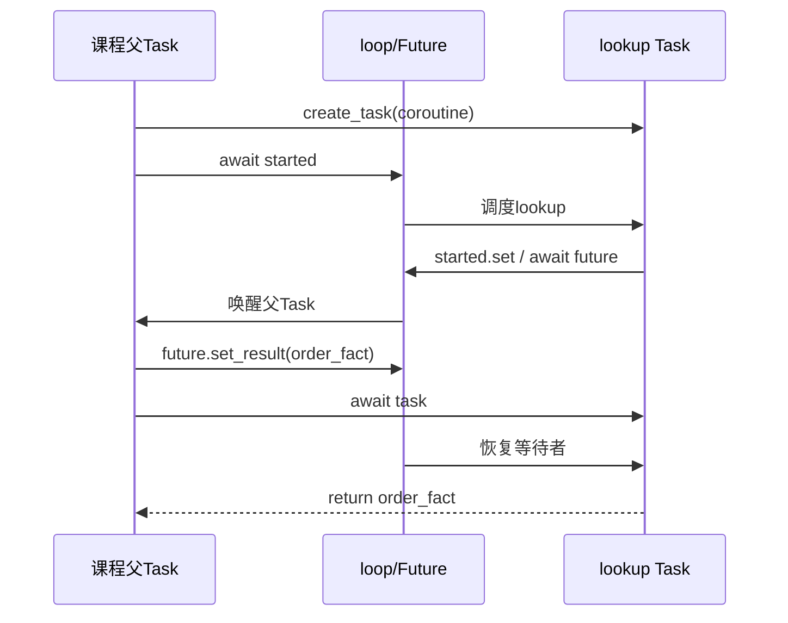

# 04｜coroutine、Task、Future与事件循环

[上一章](03-python-patterns.md) · [课程入口](README.md) · [下一章](05-coordination.md)

## 业务问题与目标

查询订单时在等网络，另一请求能否处理？调用async函数为何没有查库？目标是说清“待执行代码”“调度中的任务”和“未来结果”三个对象。前置是函数/生成器、try/finally；不需先学线程池。

## 先用普通话解释

async def定义协程函数，调用后得到coroutine对象，保存将执行的代码与局部状态；普通调用没有让它执行。await coroutine在当前Task里推进它。create_task把协程交给事件循环独立调度，返回Task，可等待结果/异常、请求取消。

Future是未来值的占位对象，常由底层I/O库创建。Task等待未完成Future时暂停，库的回调填入结果/异常，loop再让Task继续。Future不是线程，也不自己运行函数。业务层通常用库提供的awaitable，不需手工创建Future；本实验刻意创建它，展示结果由谁送回。

Java CompletableFuture可帮助理解“稍后有值”，但await不是Future.get占住事件循环线程。Task不是Java线程，单loop上同一时刻执行一个Task的Python片段；切换在协作等待点发生。已经完成的awaitable可能立即返回，await不是强制调度屏障。CPU长循环没有await会挡住同loop其他任务。

## 最小实验

离线、合成、模型0次：

```powershell
py -3.14 -m uv run --locked python -m deephelp_tools.learning.course awaitables
```

预期events为coroutine_created_not_run→worker_started→parent_sets_future→worker_received:order_fact→parent_joined，result=order_fact、task_done=true。打开[awaitables_demo](../../modules/deephelp-tools/src/deephelp_tools/learning/course/async_flow.py)。

1. lookup()后events仍空，断言说明仅创建了协程。
2. create_task创建子任务，父任务await started.wait让loop有机会运行子任务。
3. 子任务设置started后等待future；父任务看到Task/Future都未完成。
4. 父任务set_result送回order_fact，再await task收回结果。
5. 子任务继续、return；父任务在join之后才记录parent_joined。



| 对象 | 创建者/拥有者 | 启动/等待点 | 取消与清理 | 结果接收者 |
|---|---|---|---|---|
| lookup协程 | 父Task | lookup只创建；create_task启动调度 | 纳入子Task，不遗留未await协程 | 子Task |
| lookup Task | 父Task持有引用 | started后等future；父等task | 父负责取消并join；本次正常结束 | 父Task |
| Future | 当前loop | worker await；父set_result | 不跨loop/线程直接操作 | worker |
| Event | 父Task | 父等started，worker set | 无文件资源；随实验释放 | 父Task |

## 生产映射

[Conversation.run](../../modules/deephelp-app/src/deephelp_app/application/conversation/orchestrator.py)的连续await有依赖：得到归属才能绑定问题，得到意图才能找SOP，得到事实才能回复。不能把它们全部gather。相互独立的请求可以由服务调度；每个请求自己的ExecutionBudget/ContextVar保存委托与计数。

[PostgresPool/PoolLoop](../../modules/deephelp-app/src/deephelp_app/adapters/persistence/postgres.py)在Windows将libpq的selector loop和支持子进程的调用loop桥接；Future可能跨线程桥接，使用的是明确的线程安全调度，不是随手把asyncio.Future从别的线程set_result。初学时先看接口和拥有者，桥接细节可在第07章之后阅读。

## 常见误区与反例

- `await lookup(); await another()`仍是先完成lookup再开始another；写async不自动并发。
- 丢弃Task引用既失去错误接收者，也失去清理责任；优先TaskGroup或明确保存并join。
- 在正在运行的loop里再asyncio.run会报错；库函数交给已有loop await，CLI才拥有最外层run。

## 练习与答案

去掉future.set_result，预测worker/parent在哪暂停；把worker改成同步长循环有什么影响？

答案：worker等Future、父等Task，两者都不会凭空产生结果；课程30秒上限阻止无界等待。同步CPU循环会占事件循环线程，其他Task不能因为await名字就运行；应选适当线程/进程端口而非加装饰器。语义参照[Python3.14官方Task/Future文档](https://docs.python.org/3.14/library/asyncio-task.html)，本项目实际实验版本仍为3.14.7。
