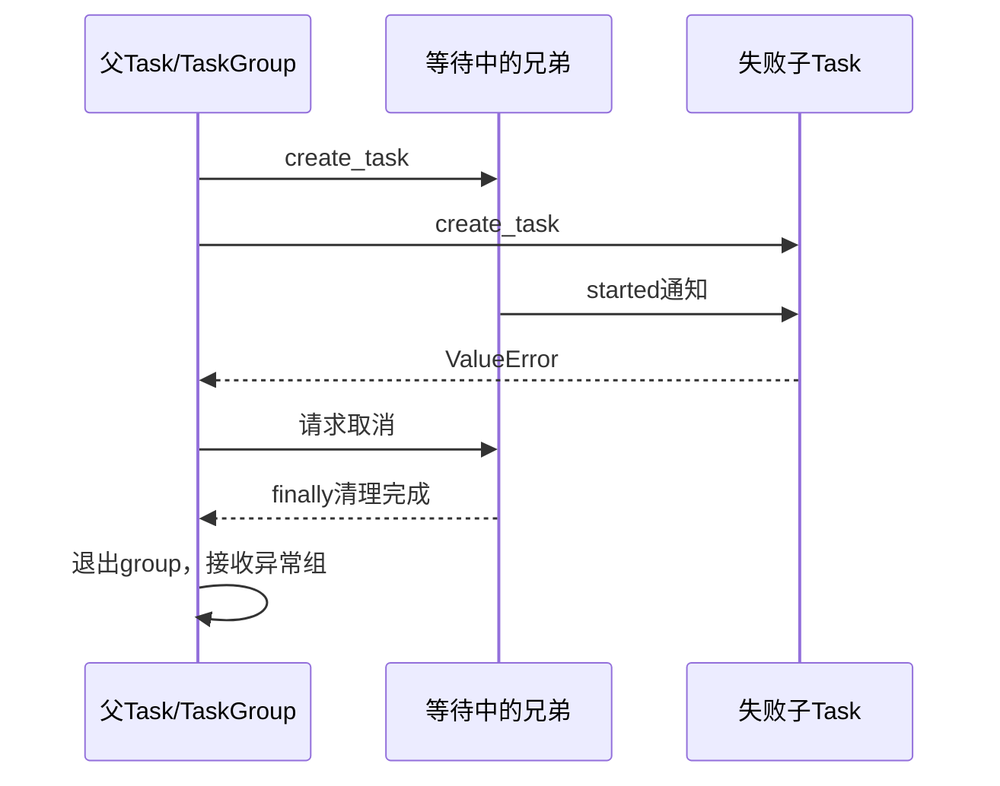

# 05｜TaskGroup、gather、Event、Lock与Semaphore

[上一章](04-awaitables.md) · [课程入口](README.md) · [下一章](06-cancellation.md)

## 业务问题与目标

两个独立查询可重叠，但一个失败后谁收回另一个？多个请求共用模型端口，怎样限制同时执行量？目标是选择协调工具并说明拥有者。前置为Task/Future及异常传播。

## 五个工具各解决一个问题

TaskGroup创建并拥有一组子Task，退出时等待它们全部结束；普通子任务失败时请求取消兄弟任务，等清理后把异常组交给父级。except*按异常类型处理ExceptionGroup子集，不能把整个失败变成假成功。

gather组合多个awaitable，正常结果按输入顺序返回，不按完成顺序。默认遇首个异常向等待者传播，其他任务仍可能运行；return_exceptions=True把异常作为结果收集，调用者必须逐项辨认。取消gather本身与“某个子任务抛错”是不同事件。Java allOf可帮助理解汇总，但不提供相同的取消/兄弟任务清理保证。

Event是通知状态：set后wait可继续，clear后新的等待会暂停；不是数据队列，也不是互斥锁。Lock保护同loop里跨await的共享不变量；同步无await的短更新不会在中间因其他Task执行而打断，但线程/多进程/数据库有别的边界。Semaphore限制同时获准进入的任务数量；不判断用户身份，不代替数据库唯一键或幂等。

## 固定屏障实验

离线、合成、模型0次；不拿耗时比值验收：

```powershell
py -3.14 -m uv run --locked python -m deephelp_tools.learning.course coordination
```

预期serial_peak=1、concurrent_peak=2、semaphore_peak=1、locked_value=2；events先出现group_sibling_cleaned再exception_group_received，并出现gather_sibling_still_pending。

打开[coordination_demo](../../modules/deephelp-tools/src/deephelp_tools/learning/course/async_flow.py)：顺序调用时release已打开，每次执行结束再运行下一个；TaskGroup实验关上release，等两个ready都set，active断言为2才释放。这里证明重叠等待，不猜毫秒调度。

失败实验中fail先等sibling启动才抛ValueError，TaskGroup取消sibling，finally清理，父级在退出后接收ExceptionGroup。gather反例同样等兄弟已启动，首错后检查另一个Task仍pending，然后显式放行并join；finally还负责收回未完成任务。限流实验里两个任务都报告attempt，Semaphore只允许一个进入。独立的Lock实验没有Semaphore在前阻挡：第一位读0后在屏障暂停，第二位已尝试进锁却不能读旧值；放行后最终计数2。



| 对象 | 创建/拥有者 | 启动/等待 | 取消/清理点 | 接收者 |
|---|---|---|---|---|
| 并发io两Task | TaskGroup | ready/release | group退出全部join | 父Task读result |
| 失败与兄弟Task | TaskGroup | sibling Event固定顺序 | 失败触发取消，finally先于group退出 | except* |
| gather两Task | 父Task | gather；首错后仍等other | finally取消未结束者、gather收尾 | 父Task逐项处理 |
| Semaphore/Lock | 实验拥有者 | acquire/async with | 出块归还，无线程间保护 | bounded任务 |

## 当前代码

[ExecutionBudget/AsyncCalls](../../modules/deephelp-app/src/deephelp_app/domain/execution.py)在派发前占尝试/预留，限流排队也耗总deadline；claim_attempt检查和扣减间没有await，保护同loop计数。不是所有计数都要加Lock，关键是跨什么并发边界。[MCP网关](../../modules/deephelp-app/src/deephelp_app/adapters/mcp/business/tool_gateway.py)复用该执行门禁；最终业务唯一性仍由PG/工具账本保障。

## 常见误区与反例

- gather抛错后直接return会遗留兄弟任务；必须明确join/取消。
- Lock范围包括人工审批会让别人一直等；锁和数据库事务都应短时。
- Event通知发生后clear太早可能让后来的等待者重新挂住；给通知设计固定生命周期。

## 练习与答案

预测把TaskGroup换为默认gather后sibling是否自动收到取消；把Semaphore(1)改2又改变什么？

答案：默认gather首错不自动取消兄弟，需拥有者处理；Semaphore(2)允许两个执行区重叠，不改变权限和幂等。独立结果汇总与同生共死工作组的目的不同。参照[官方协调原语](https://docs.python.org/3.14/library/asyncio-sync.html)与[TaskGroup/gather](https://docs.python.org/3.14/library/asyncio-task.html)。
