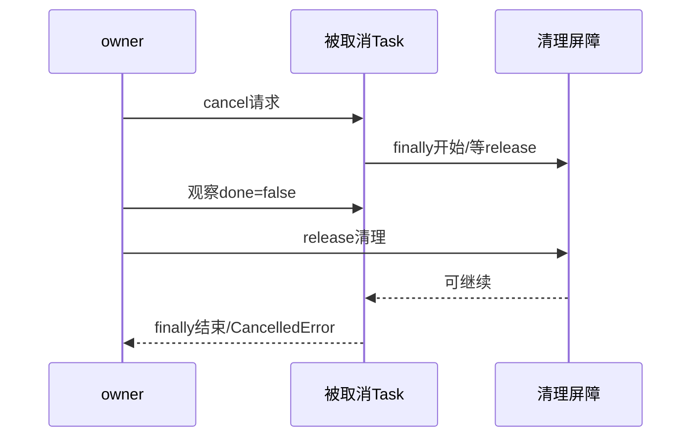

# 06｜deadline、timeout、取消、shield与finally

[上一章](05-coordination.md) · [课程入口](README.md) · [下一章](07-resources.md)

## 业务问题与目标

请求取消时，查询是否停了、结果是否保存、后台线程是否还工作？目标是分别观察取消前、取消请求后和finally完成后，理解短时终态保存与未知效果。前置为Task、Future、Event和所有权。

## 取消不是立即完成

task.cancel()提出取消请求，在可注入点触发CancelledError；调用后done/cancelled不必立即为true。finally可能还有异步清理，创建者需await task确认完成。CancelledError属于BaseException，不在普通except Exception里；清理后通常重新传播，不能吞掉让上层误判成功。

总deadline从请求开始计算，排队、网络、重试退避都消耗同一剩余时间。asyncio.timeout围绕等待注入取消，在上下文外转为TimeoutError；不能保证强停外部世界。shield保护被等待Task不受外层这一条取消传播，外层自己仍抛CancelledError，拥有者仍需要持引用和收回writer。

## 实验与预期

离线、合成、模型0次；用Event和到期调度，不用严格耗时：

```powershell
py -3.14 -m uv run --locked python -m deephelp_tools.learning.course cancellation
```

before显示done=false/cancelled=false/cancelling=0；requested显示仍未完成、cancelling=1；during_finally仍未完成；after在finally完成并被owner await后才cancelled=true。events还包含writer_committed早于shield_owner_joined、queue_deadline_received、await_cancelled_thread_still_running早于thread_joined_by_owner。

按[cancellation_demo](../../modules/deephelp-tools/src/deephelp_tools/learning/course/cancellation.py)逐步读：worker_started固定取消时点；finally设置cleaning后等release_cleanup，父任务能在清理中观察pending；释放清理后await接收取消。shield子实验取消outer，检查writer未被取消，放行commit，等writer完成后再传播外层取消。队列实验用Semaphore(0)制造确定等待，到期后不获得执行槽位。

线程实验用to_thread启动阻塞工作，线程通过call_soon_threadsafe通知loop“已开始”；取消等待Task后线程仍在等threading.Event。finally放行线程并等finished，才完成资源收回。这个效果由真实运行线程证明，不是用“取消可能不生效”文字推测。线程的阻塞等待有5秒兜底，实验不遗留永久线程。



| 对象 | 创建/拥有者 | 启动/等待点 | 取消来源/清理完成 | 接收者 |
|---|---|---|---|---|
| worker Task | 父Task | started后等永久Event | 父cancel；release_cleanup后finally结束 | 父await |
| shield writer | request_owner，保留引用 | writer_started后等commit | outer取消不传入；commit后join | request_owner再抛取消 |
| queue等待 | 当前Task | Semaphore.acquire | timeout到期；未派发业务 | 外层TimeoutError |
| 工作线程 | 默认executor/课程拥有者 | to_thread；threading.Event | await取消不杀线程；finally放行/等finished | 课程owner |

## 主链映射与实际边界

[terminal.finish_run](../../modules/deephelp-app/src/deephelp_app/application/conversation/terminal.py)创建短时persist Task，5秒存储宽限只允许ledger.finish；shield不授权继续模型/工具。第一次外层取消时等writer再传播。代码不是无限次取消或进程强杀下的提交保证；第二次取消可能打断普通await writer，存储失败也会传播。账本已有RUNNING/UNKNOWN时要对账，不把旧任务盲目重跑。

[Conversation._run](../../modules/deephelp-app/src/deephelp_app/application/conversation/orchestrator.py)接收取消后形成CANCELLED响应并走终态，最后向调用者传播。若在领取前取消，没有新receipt可保存；领取后中断则账本记录是恢复入口。诊断在事实后，不让观测恢复业务效果。

## 常见误区与反例

- Future.cancel和Java线程interrupt都不是通用强杀；任务、线程、进程、数据库各有协议。
- 给每次重试重新建总预算会让总时限无限延长；传原预算和剩余时间。
- shield包住整条Agent会导致取消后还消费模型/工具；只保护必要短时存储。

## 练习与答案

预测删掉except CancelledError里的await writer；再预测远端执行成功但回复连接丢失。

答案：第一种会留下未收回writer，caller不知道落盘是否完成；第二种不能由超时证明未执行，应标UNKNOWN并按同operation查询对账。参照[官方取消、shield、timeout和to_thread语义](https://docs.python.org/3.14/library/asyncio-task.html)，运行证据来自本章固定实验。
