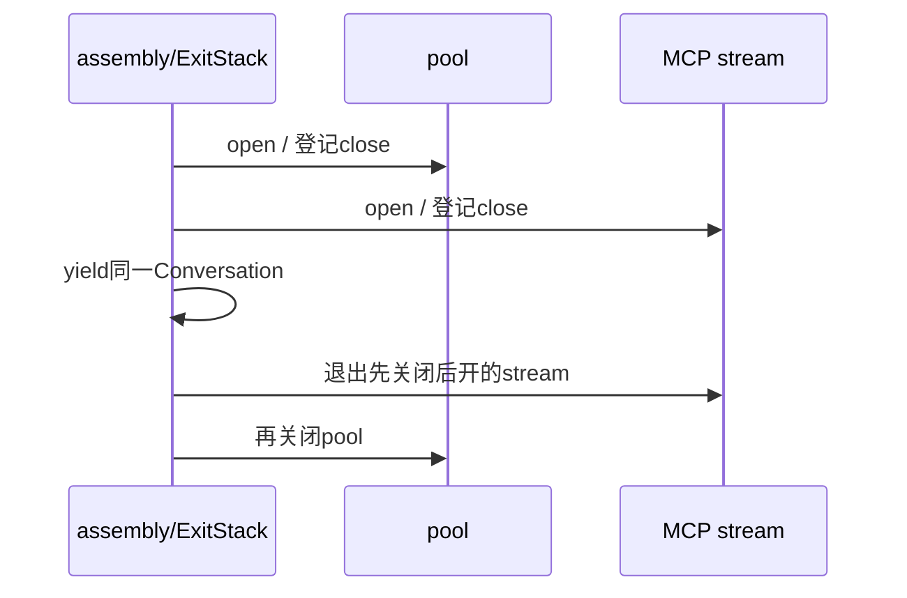

# 07｜HTTP池、PG事务、MCP与子进程的生命周期

[上一章](06-cancellation.md) · [课程入口](README.md) · [下一章](08-message-path.md)

## 业务问题与目标

模型/数据库/stdio都可能等待，谁打开它们、谁关闭？人等审批时能否留着事务？目标是画出启动、借用、提交和清理边界。前置为async with、Task取消和finally。

## 用所有权理解资源

HTTP client拥有连接池，通常由应用lifespan创建，多个请求借用；请求不能关闭共享client。PG pool拥有连接，请求借连接、开短事务；commit使账本事实持久，rollback撤销未提交更改，归还连接不是“自动业务成功”。不能跨模型长调用或人工等待持业务事务。

MCP stdio传输拥有子进程/管道，SDK session拥有协议收发。ToolGateway.open在同一Task进入/退出SDK作用域，避免AnyIO取消域栈跨任务关闭。Streamable HTTP使用独立服务，关闭客户端等待不保证服务停止，更不撤销已提交结果。

AsyncExitStack把动态打开的资源的退出动作逐个登记，退出逆序关闭，后续打开失败也关闭此前成功项。像Java try-with-resources，但异步关闭也可await；push_async_callback登记拥有者的aclose，enter_async_context登记完整进入/退出协议。

## 最小实验

离线、合成、模型0次；资源栈是机制示范，子进程是真实本机进程：

```powershell
py -3.14 -m uv run --locked python -m deephelp_tools.learning.course resources
```

预期normal为open:pool→open:stream→close:stream→close:pool；error同样逆序关闭后error_received；partial_open只关闭成功打开的pool；cancel在逆序清理后才cancel_received。subprocess为child_ready→child_exited→owner_cancel_received、child_exit_code=0。

打开[resources_demo](../../modules/deephelp-tools/src/deephelp_tools/learning/course/resources.py)：每种scenario有独立events/context，避免循环闭包捕获后续值。child_owner用create_subprocess_exec启动只等stdin的合成Python进程；读到ready再设置屏障。父task.cancel不会自动杀进程，finally向stdin写stop、关闭管道、wait得到退出码之后才结束。正常子进程协议无需强杀，异常服务的停止/杀死另有SDK与原探针边界。



| 对象 | 创建/拥有者 | 启动与借用 | 取消/关闭完成点 | 结果接收者 |
|---|---|---|---|---|
| HTTP client | 应用lifespan | 进入async with，请求借用 | 应用退出aclose | 各请求await响应 |
| PG pool/连接 | assembly/请求 | open；acquire；cursor | commit/rollback后归还，应用关闭pool | ledger/请求 |
| MCP stdio SDK | ToolGateway.open的Task | session进入；初始化/发现/调用 | 同Task __aexit__，SDK回收进程 | ToolGateway/用例 |
| 实验子进程 | child_owner | ready握手后wait | owner取消后finally明确停止并wait | 父Task接收取消 |
| ExitStack | assembly | 按成功进入登记 | 失败/正常/取消都逆序退出 | 外层保持原异常 |

## 当前生产路径

[LiveAssembly.open](../../modules/deephelp-app/src/deephelp_app/bootstrap/runtime/assembly.py)拥有AsyncExitStack，先检查明确MCP配置，再打开PG/审批/cache/工具/检索并yield Conversation。共享HTTP client由外层lifespan传入，assembly不误关借用资源。[ToolGateway.open](../../modules/deephelp-app/src/deephelp_app/adapters/mcp/business/tool_gateway.py)负责SDK作用域与finally退出。

[PostgresLedger.finish](../../modules/deephelp-app/src/deephelp_app/adapters/persistence/ledger.py)在同一个短事务里检查run状态/问题版本、更新终态、登记changed/outbox后commit，任何异常含取消走rollback。[PostgresPool](../../modules/deephelp-app/src/deephelp_app/adapters/persistence/postgres.py)拥有Windows桥接loop，关闭池后才关闭桥接，不把连接带入DTO。

实际stdio初始化/schema/取消/退出可从根运行原离线协议测试，模型0次；它只证明本机合成协议：

```powershell
py -3.14 -m uv run --locked pytest modules/deephelp-app/tests/integration/test_m06_stdio.py -q
```

## 常见误区与反例

- 用户等十分钟审批不能持十分钟事务，先保存plan/checkpoint并提交，明确批准后新事务领取。
- 关闭等待Task不关闭共享client，也不撤销远端效果。
- finally是协议出口，不保证进程强杀后还会执行；恢复必须依赖持久账本。

## 练习与答案

stream打开失败后pool是否关闭？事务commit成功但Langfuse导出失败，应回滚业务吗？

答案：已登记pool退出仍执行；未成功进入stream没有对应退出。已提交业务不能因诊断失败伪装回滚，也不能重新执行工具，应显示缺失诊断并读原receipt。参照[官方AsyncExitStack](https://docs.python.org/3.14/library/contextlib.html#contextlib.AsyncExitStack)。
