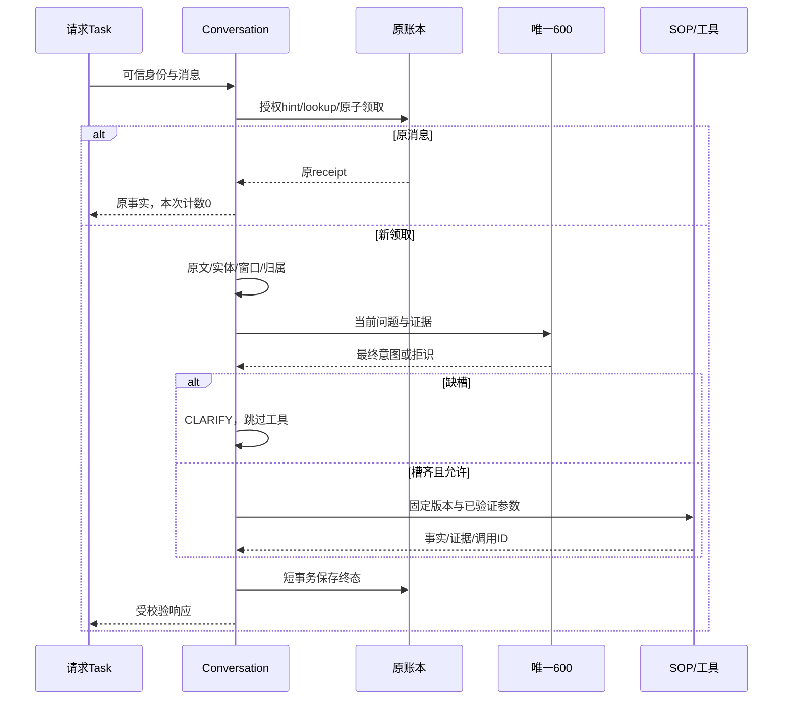

# 08｜一条客诉的13段与原receipt

[课程入口](README.md) · 前置：[上手](01-start.md)、[类型](02-values.md) · [下一章](09-agent-basics.md)

## 业务问题与目标

“优惠没到账”缺订单号；补充000031要续接原问题；重发同一消息要读原结果。目标是指出判断、等待、工具效果和落盘位置，而不只是背名称。

## 四个ID

message_id标识消息，request_id标识本次传输，question_id标识持续问题，run_id标识一次领取执行。trace_id只关联诊断，不授权。补槽为新message、新run、原question；重投为新request/trace、原run/receipt。正式入口注入identity，正文不能自授权限。

## 实验与预期

离线、合成、远程模型0次；与01章同一权威实验，可复用同一次输出：

```powershell
py -3.14 -m uv run --locked python -m deephelp_tools.learning.course request
```

比较missing/answered的question_id、answered/replay的run_id；核对facts中的evidence_id、evidence中的record_id与工具记录。预期缺槽0工具、补槽1工具、重投0新增调用、物流0工具。13段都有状态，skipped明确表示没执行。

## 实际时序



preparation可在领取前完成文本/事件计算，用于原子绑定正确问题，不是所有处理都在accept之后。hint授权先于receipt读回；未领取新执行就不再跑业务。

| 段 | 解决的问题 | 阅读点 |
|---|---|---|
| 100/200 | 输入/安全 | identity、DTO、归属 |
| 300/400/500 | 清洗/上下文/问题归属 | preparation/state/EventAggregationService |
| 600/700 | 一次主意图/有效目录 | IntentService.recognize |
| 800/900 | 缺槽/固定SOP | required_slots、版本 |
| 1000 | 有界工具/事实 | SOPExecutor.execute |
| 1100 | 事实写成回复 | ReplyComposer.compose |
| 1200/1300 | 问题版本/响应闭合 | Question/ResponseEnvelope |
| 收尾 | 终态事务后诊断 | finish_run/ledger.finish |

## 源码走查

[Conversation._run](../../modules/deephelp-app/src/deephelp_app/application/conversation/orchestrator.py)先算missing，缺槽构造WAITING_SLOT而不调用execute。[IntentService](../../modules/deephelp-app/src/deephelp_app/application/intent.py)只在600调用，500只判“哪个问题”。[SOPExecutor](../../modules/deephelp-app/src/deephelp_app/application/sop.py)检查白名单、参数、validate_tool_result；模型建议不是事实。

[reply.fact_reply](../../modules/deephelp-app/src/deephelp_app/application/reply.py)从Money生成数字；语气模型只能选固定词。[finish_run](../../modules/deephelp-app/src/deephelp_app/application/conversation/terminal.py)先账本终态后诊断；平台失败不能重放已执行效果。实验内存repo进程退出消失，不替代PG重启持久验收。

## Java类比与误区

Conversation像应用服务编排；await不阻塞事件循环线程，当前Task等待时可运行别的Task，已完成await也可能直接返回。多请求并发与单请求顺序依赖可以同时成立。

- 13段不等于13次模型；规则/检查/持久化不是API。
- 幂等不是按文本去重或Redis缓存；账本唯一领取，工具/审批另有幂等边界。
- 终态也可能失败/取消；不能把落盘当ANSWERED。

## 练习与答案

预测缺槽→补槽的工具次数、question/run；同message_id换正文如何处理？

答案：0→槽齐合法后才查，question相同、run不同；改正文是幂等冲突，不能覆盖原receipt。交错和取消的原断言见[主链测试](../../modules/deephelp-app/tests/integration/test_m12_pipeline.py)。
