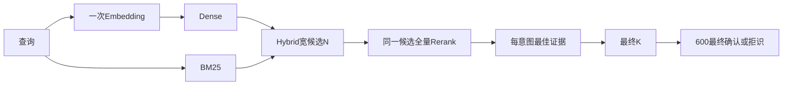

# 10｜Dense、BM25、Hybrid、Rerank与最终意图

[上一章](09-agent-basics.md) · [课程入口](README.md) · [下一章](11-memory.md)

## 业务问题与目标

用户说“券用不了”，语料既有优惠也有券。如何找到资料、排序，再决定最终意图？目标是区分文档召回、文档重排、每意图归并和分类。前置为模型端口、DTO和唯一600。

## 普通话解释与Java类比

Dense将查询/资料编码为同一向量空间，用相似度找语义接近资料；Embedding模型、维度、预处理签名改变就要新集合/reindex。BM25使用词项匹配与词频/文档长度等统计，能补编号、关键词等词面信号；不是另一种主意图模型。Hybrid融合同一查询的两路排序。向量检索类似候选索引，BM25类似搜索引擎词项索引，但不是SQL精确主键查询。

Rerank把查询和已经召回的文档一起评分，重新排序，不能找回没进候选集的文档。当前路径是宽召回N→重排全部N→每意图取最佳证据→最终K；提前裁成K或先把每意图合成一条会丢可重排的证据。分数带score_kind：cosine、bm25、fusion、rerank量纲不同，不能当统一置信概率。

600的Cascade使用规则、当前已确认问题、检索证据及必要模型判断给最终意图/拒识。最相似文档所属类只是候选，未知物流不能因为语料里一定存在某个“最近”样例就强制选择它。

## 实验与预期

离线、固定合成向量与重排端口、远程模型0次；复用生产HybridRetriever，不证明模型效果：

```powershell
py -3.14 -m uv run --locked python -m deephelp_tools.learning.course retrieval
```

预期candidate_ids为discount-a、discount-b、coupon；embedding_actions=1、rerank_actions=1；前三路的最佳意图证据为discount-a/coupon，重排后为coupon/discount-b；raw_scores_preserved=true。fusion_example约0.872，只是排序分数。

按[retrieval_demo](../../modules/deephelp-tools/src/deephelp_tools/learning/course/retrieval.py)读：

1. 创建完整HybridScope，签名是明确的合成二维空间，不混入正式1024维集合。
2. 三份DenseHit携带raw_dense/raw_sparse/fusion_score/matched_sources，不只写“成功”或分数。
3. compare只获取一次查询向量，再传给同一Store.routes，三路共享候选上限。
4. FixedReranker故意把coupon排前、discount-b排在discount-a前，返回原文档的index。
5. rerank_result映射回本地不可变文档，保留融合原分数；按排序先后每意图取一份，再取K=2。



## 当前源码与证据

[hybrid.normalized_fusion/result_for/HybridRetriever.compare/rerank_result](../../modules/deephelp-app/src/deephelp_app/application/hybrid.py)分别处理分数、每意图归并、共享查询和重排；[DenseHit/RerankPolicy](../../modules/deephelp-app/src/deephelp_app/domain/models/retrieval.py)要求来源/范围，top_n必须等candidate_budget。[cascade](../../modules/deephelp-app/src/deephelp_app/application/cascade.py)负责最终确认，不把排序名次直接当分类概率。

正式Milvus端见[milvus_hybrid](../../modules/deephelp-app/src/deephelp_app/adapters/retrieval/milvus_hybrid.py)；独立服务见[Retrieval backend](../../modules/deephelp-services/src/deephelp_services/retrieval/backend.py)。当前正式是否开启重排、历史内容通过与退化都以[PROJECT_STATE](../PROJECT_STATE.md)和[M31交接](../../handoffs/M31.md)为准，本章不改变策略或启用模型。

## 常见误区与反例

- 一类资料多就把分数加总会偏向资料多的类，当前取最佳证据。
- “Embedding维度一样”不等于向量空间一样，签名含模型/供应商/预处理等字段。
- 0.9融合分数不是90%正确率；拒识门限需要固定内容样本与校准证据。

## 练习与答案

预测先只保留discount-a/coupon再Rerank，是否还能选discount-b？只把top_n从3改1呢？

答案：被裁掉的discount-b无法恢复，实验要先保留全部3份。top_n=1与N=3不匹配，RerankPolicy拒绝。正确扩大N也需要实际覆盖/延迟/预算验证，不能拿本合成排序证明真实质量提升。

## 语料作者、导入与审核（M44）

在“识别与检索”读取工作区，新建候选时选择当前目录叶子标签，填文本、split、来源说明和来源/近义组。保存后读取真实revision；编辑已审核记录退回DRAFT。删除只影响作者候选。PG按owner+目录隔离，短事务锁内核对revision、完整校验后提交；模型等待不占此锁。

JSONL沿用CorpusRecord；CSV用冻结字段名或字段→表头映射；Excel用字段→A/B列映射，单工作表、文本单元格，公式拒绝。必需字段doc_id/content/intent_code/split/source_group/variant_group/synthetic；v3还须registry_version=complaints-v3，来源说明可写metadata.source。先预览逐行修正错标签、缺列、重复ID/跨split近重复，再明确导入全部行；之后人工核对并填写理由批准所选记录。

```powershell
py -3.14 -m uv run --locked python -m deephelp_tools.learning.course corpus-authoring
```

预期父标签INVALID_ARGUMENT、失败导入0行、预览0条草稿、导入DRAFT、审核APPROVED，模型0。实验复用纯变换，不证明PG持久协议。Java可类比聚合version乐观锁及单事务批量写；数据库事务不与前端编辑时长绑定。

常见错误：dev/test进入业务索引、同义改写冒充独立split、高置信自动金标、响应超时直接重投。练习：10行中第7行父标签，保存几行？答案0。提交响应丢失时先读同preview_id的IMPORTED/imported_revision对账，不能清零revision绕过冲突。

### 冻结、候选索引与对照

在同页读取冻结版本，给已审核聚合一个新版本名并明确冻结；course现在还输出frozen_version=course-v1。快照保存来源、split、审核主体/理由和各记录revision/hash。以后修改草稿必须重审、冻结新版本；冻结版本不是可编辑的工作区。

确认共享预算后启动候选构建。LearningJobs拥有唯一worker、超时和cancel/join；应用拥有借来的gateway/累计writer；构建函数只拥有新Milvus客户端，在finally关闭。candidate集合由审核hash和完整Embedding签名决定，原正式集合、active/previous不被覆盖。dev/test在调用前冻结，沿原dataset检查来源组/文本泄漏；仅reference/train进入索引。当前权重候选在heldout调用前固定，test不能反选权重。

Java可类比不可变快照、Future取消和可重建查询投影，但远程upsert结果未知不等于事务回滚。模型已返回的向量在下一await前保存pending journal；恢复先核对内容/来源/向量hash，再用同PK写入/读回，不能重新付费生成它。完成观察逐条保存；读取、恢复已完成索引也要复核真实远程字节，缺失或篡改拒绝，不把本地VERIFIED当永真。

明确执行对照后，页面显示候选/正式版本共用的实际查询向量hash、Dense cosine、BM25词项分数、Hybrid归一融合、配置Rerank的实际状态，以及各路耗时/文本/来源。未配置重排为not_run，不能补画第四路。固定合成样本的改善/退化与未运行分类分别记录；召回到物流近似语料仍不能越过最终分类守卫。练习：已写入Milvus但回执丢失，恢复要再Embedding吗？答案：有已确认pending向量时先核对journal，再写/读回同PK；没收到模型结果时用量仍未知，不能伪称已有向量。

### 原反馈、新版本与完整发布

先在原“评测与反馈”采集已结束run并人工批准corpus路线，声明标签与heldout独立；作者页输入候选ID及审核revision，服务器读取原候选的脱敏文本、原run和人工标签，进入DRAFT。模型预测、高置信或平台分数不批准它。再次核对作者记录并审核，冻结新版本；旧版本的来源、审核、文本和索引保持可读。版本差异显示新增/删除及完整条目修改，删除工作区记录不会删除原run所依赖的历史字节。

按页上的顺序执行候选索引→最终分类与退化门禁→六叶子业务与未知范围验收→准备完整清单→原CAS发布。分类复用已完成检索观察，不再Embedding；策略沿原当前版本，只重绑定候选scope/hash，不能借test调权重或放宽阈值。每条最终结果保存后才运行下一条，恢复跳过已确认结果；代码/配置/观察变化拒绝借用旧门禁。页面列出Dense/BM25/Hybrid的dev/test差值及两版本最终分类正确率；持平如实显示，未配置Rerank和独立客户分布不宣称已验。

发布复核作者快照、索引、冻结split、规则、Prompt、SOP、Skill、代码和本次业务报告，并在同一个PG事务内再次锁读当前反馈revision及active CAS。审核撤销与发布提交串行；原lineage记录本次不可变资产hash。Java可类比不可变构建产物加短事务乐观锁；Milvus投影、业务事实、模型计量和已发生工具效果不随发布指针回滚。prepare只是READY；完整安装和目标配置成套切换后才是新运行，旧进程仍固定启动版本。

离线`course corpus-authoring`另输出version_diff_changed=1、old_snapshot_rows=1、deleted_workspace_rows=0、model_calls=0。练习：分类全对但Hybrid MRR下降能发布吗？答案不能，先保留FAIL及原盲测；不要改金标或扩大预算换PASS。练习：发布后撤销反馈，能清除旧发布文件吗？答案不能；旧run/恢复仍引用它，新的publish先核对当前审核，修订须新版本重验。
