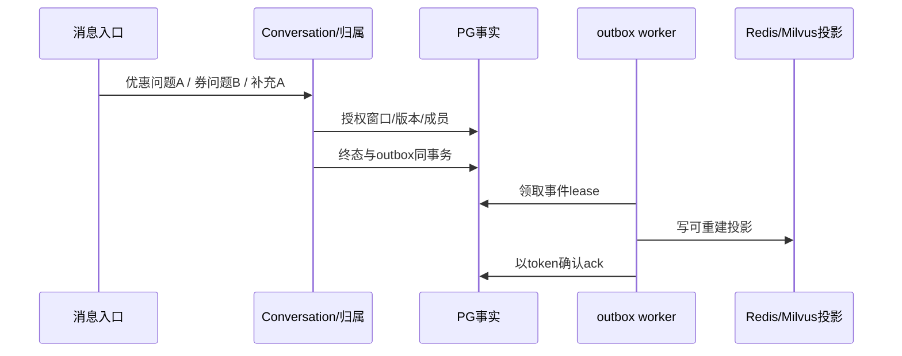

# 11｜多轮问题、PG账本、outbox与可重建投影

[上一章](10-retrieval.md) · [课程入口](README.md) · [下一章](12-approval.md)

## 业务问题与目标

先问优惠，插入一个券问题，再补订单号，会补到哪个问题？Redis丢了还能查原事实吗？目标是分清“语义归属”与“持久事实”，避免按最近一条无条件合并。前置为第08章四个ID、槽位与版本。

## 先分清存的是什么

PG保存接收/终态、问题成员/版本/实体来源、工具与审批操作、outbox、发布引用等权威关系事实。Redis保存可重建窗口投影，Milvus既可有意图语料索引也可有单独问题摘要索引，两个scope用途不同。官方saver保存图的运行状态/父checkpoint/pending writes；Langfuse保存诊断观测。后两者都不批准退款，也不替代账本。

MemoryService.load先读授权、有限的PG快照；语义摘要候选还要回PG核对身份、版本和状态。缓存失效不是“切到demo事实”理由。类似Java CQRS读模型，但这里事实仍由同一PG事务提交，不用缓存或搜索索引决定谁拥有问题。

outbox与问题更新在同一事务登记，worker领取带lease的事件，写投影后ack；失败可重试，取消不能确认未知投影写成功。投影幂等/版本检查使重复事件安全，不能只靠“队列一般不会重复”。事务不是跨三个存储的分布式提交。

## 交错问题实验

离线、合成内存仓储/固定归属判断/本机stdio，远程模型0次：

```powershell
py -3.14 -m uv run --locked python -m deephelp_tools.learning.course memory
```

预期first优惠缺order_id，other为000042券问题缺coupon_id，两个question_id不同；completed补000031回first，ANSWERED且99.90/10.00；other_kept_order仍为000042，没有被000031污染。

按[memory_demo](../../modules/deephelp-tools/src/deephelp_tools/learning/course/request.py)逐步看：两个不同诉求分别运行Conversation，MemoryService读取同session已有窗口；ReplayJudge显式给出supplement到first的固定证据，真实归属约束继续执行，随后补槽/600/SOP/终态全用原引擎。固定judge只演示已有答案下的机制，不证明真实模型能判所有交错话题。



## 当前源码

[MemoryService.load/ProjectionWorker.once](../../modules/deephelp-app/src/deephelp_app/application/memory.py)展示权威快照、摘要复核、cache_error、取消不ack；[PostgresCaseRepository](../../modules/deephelp-app/src/deephelp_app/adapters/persistence/cases.py)负责关系状态与outbox。[preparation.prepare](../../modules/deephelp-app/src/deephelp_app/application/conversation/preparation.py)在领取前准备归属，原账本原子绑定问题与消息。

[事件aggregation/policy](../../modules/deephelp-app/src/deephelp_app/application/event_cluster/aggregation.py)限制候选和合并，更正保留旧/新来源，不把不同订单当同一实体；[state.advance_question](../../modules/deephelp-app/src/deephelp_app/application/conversation/state.py)推进实体、冲突与固定版本。显式question_hint仍必须授权，不能从正文猜身份。

## 常见误区与反例

- “最后一个问题”不一定是补充目标。两个同时缺同类槽位时可能要澄清，不能盲接。
- Redis有记录不授权读它；身份/session/版本回PG核对。
- message_id重投不重新判断归属，也不重做工具；文本变更是幂等冲突。

## 练习与答案

订单000053被更正为000042，是否删除原来源？outbox写Milvus成功但ack前进程结束呢？

答案：保留旧值、新值与各message来源，纠正不是证明两个订单等价。ack前中断可由lease到期重新领取；投影按原问题/version幂等，不重新执行业务。更多固定反例从根运行[原记忆测试](../../modules/deephelp-app/tests/unit/conversation/test_m10_memory.py)，不连接真实PG/Redis/Milvus：

```powershell
py -3.14 -m uv run --locked pytest modules/deephelp-app/tests/unit/conversation/test_m10_memory.py -q
```
