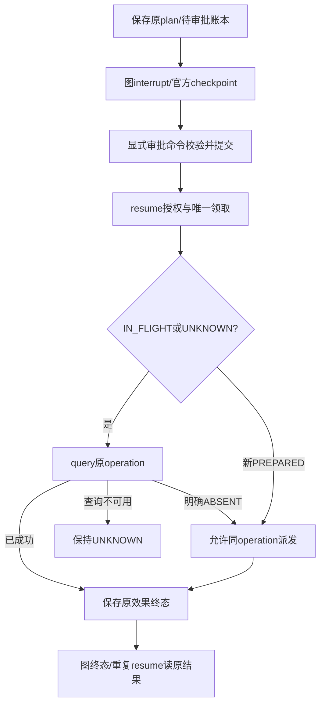

# 12｜审批、checkpoint、UNKNOWN与恢复

[上一章](11-memory.md) · [课程入口](README.md) · [下一章](13-observations.md)

## 业务问题与目标

“建议补优惠”不等于已执行；执行后回复丢失也不等于没执行。目标是说明暂停/批准/恢复分别存什么，UNKNOWN为何先对账。前置为ID/版本、事务和取消。这里使用原ApprovalService实际图，不新建第二套状态机。

## 计划与批准绑定什么

SOPPlan固定operation_id、可信identity、question/version、参数hash、SOP snapshot、证据和完整发布；ApprovalCommand带session/run/原操作绑定。代码校验当前归属、审批状态/有效期、原问题版本与版本资产，PG原子领取token保证同一操作唯一执行。普通“好”“继续”消息走Conversation，不能批准旧操作。

官方AsyncPostgresSaver保存图状态、父checkpoint、频道版本和pending writes；interrupt暂停在审批节点，resume从保存状态继续，包含interrupt的节点可能重新执行。因此interrupt之前不能放不可逆副作用；当前approval_wait只读账本。图线程ID关联原run，恢复不创建新operation。人工等待不占业务事务；审批决定先提交PG，再显式恢复图。

Java工作流持久状态可类比checkpoint，但批准是业务事实，图快照不是授权凭证。checkpoint落后于已提交终态时可从账本修补图；不能拿旧图状态把效果重新执行。

节点重入与同thread_id恢复的库语义参照[LangGraph官方interrupt说明](https://docs.langchain.com/oss/python/langgraph/interrupts)；本章绑定当前锁定版本和原ApprovalService，不采用在线文档中新接口来替换现有调用。

## 最小可运行UNKNOWN实验

从根运行原固定测试，离线/合成下游、模型0次；真实LangGraph图与内存saver证明算法，不证明PG跨进程持久性：

```powershell
py -3.14 -m uv run --locked pytest modules/deephelp-app/tests/unit/approval/test_m15_approval.py -k unknown_queries_before_any_redispatch -v
```

预期3个反例通过：查询已成功只call query，查询明确ABSENT才query→execute，查询不可用保持UNKNOWN、不commit。前两种终态重复resume不增调用。

逐步读[test_unknown_queries_before_any_redispatch](../../modules/deephelp-app/tests/unit/approval/test_m15_approval.py)：fixture固定原OperationRecord与证据；OfflineAuthority模拟账本领取，call记录query/execute；测试直接调用生产ApprovalService.resume；InMemorySaver保存真实图状态；断言不是检查HTTP200，而是效果查询/派发顺序和终态/重投计数。正式数据库领取并发由独立持久验收证明。

## 生产执行顺序



[ApprovalService.graph/resume](../../modules/deephelp-app/src/deephelp_app/application/approval.py)有approval_wait、execute_operation、reconcile_effect三个真实节点。execute先查未知，dispatch记录已派发，再调用合成权益；取消/异常记录UNKNOWN，reconcile根据同operation效果落账。resume的finally释放领取token；终态不再派发，只修补checkpoint缺口。

[ApprovalRepository](../../modules/deephelp-app/src/deephelp_app/adapters/approval/approval_store.py)承担绑定/事务/唯一领取，[PostgresCheckpoints](../../modules/deephelp-app/src/deephelp_app/adapters/approval/postgres_checkpoints.py)仅适配官方公共接口。历史真实独立进程与原ID恢复见[M26交接](../../handoffs/M26.md)，不是本章重跑结论；当前新代码字节仍须通过原发布守卫才能恢复非终态操作。

## 常见误区与反例

- timeout只说明没拿到确定结果，不能说明远端没有副作用。
- 新Prompt或新订单参数不能用于批准旧plan，要重新预检/绑定。
- 未批准、越权或丢原资产不能用“恢复学习实验”绕过守卫。

## 练习与答案

对账接口不可用时是否可重发execute？业务已commit但checkpoint未写成终态呢？

答案：保持UNKNOWN等待对账，不能盲重放；若账本已有可信终态，修补图状态并读原结果，不增加效果。取消可能中断对账，下一次仍按账本UNKNOWN处理，而不是重规划。
