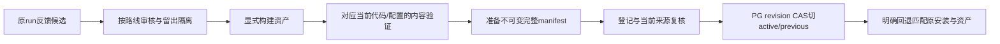

# 14｜固定评测、反馈审核、完整发布与回退

[上一章](13-observations.md) · [课程入口](README.md) · [源码导航](source-navigation.md)

## 业务问题与目标

改了Prompt后旧报告PASS还能发布吗？一次错误对话能否自动变训练答案？目标是把候选、gold、模型内容证据、版本门禁和active切换连起来。前置为检索签名、账本版本和证据边界。

## 先把数据角色说清楚

reference/train用于运行召回/训练；dev用于调参；冻结test用于未见内容验证；regression保留已知反例。source_group/variant_group控制原来源与改写族隔离，换订单号不算新独立样本。调试过的test不能继续宣称未见；同作者合成组不等于企业代表性。

反馈candidate是待核实对话，gold是每条路线显式审核、带来源/标签/独立性证据的答案。规则、Dense与FastText三路各自审核，批准不自动训练、发布或启用。原run、review revision、撤回和lease让处理可审计；不能把模型自己的答案直接当真值。

完整ReleaseManifest绑定模型/配置、Prompt工件、SOP snapshot、规则、语料/Embedding签名、FastText、精确runtime字节、验证报告及审核来源。运行核对的是当前字节和状态，文件hash相同只是必要条件；报告目标、版本与行为范围也必须适用。像Java可追溯制品与数据库CAS，但不是Git分支名一改就自动切换服务。

## 最小实验与预期

离线、模型0次；审计现有小冻结集并用合成报告结构演示原门禁，不运行完整质量评测、不发布：

```powershell
py -3.14 -m uv run --locked python -m deephelp_tools.learning.course evaluation
```

预期case_count=16、turns=20、synthetic_ratio=1；scenario_scale_complete/scale_500_complete均false。这是默认小冻结集，不把当前项目另有的548会话规模混进本次审计。synthetic_selected_gate.accepted=true只说明固定合成结构满足selected门禁；interrupted_gate/hard_failure_gate均false；empty_denominator.value=null。

按[evaluation_demo](../../modules/deephelp-tools/src/deephelp_tools/learning/course/evidence.py)看：audit读包内冻结原件核对来源/标签/分组；构造明确的合成selected报告；complete=False模拟中断，wrong_owner模拟安全失败；targeted_gate逐项拒绝。ratio空分母保留未知，不编100%通过。实验不生成可以注册发布的content报告。

## 独立来源、双盲标与锁定留出集

M45把作者输入与标注收据分开。不同作者不等于真实客户：`independent_ai_synthetic`明确表示AI独立合成，两个标注者也分别声明只看新输入/业务定义；实际导入/提交主体另行持久记录。作者不能自审，两个完整标签有分歧时第三位主体复核，不能用模型回答确认gold。近重复/会话组不能跨train/dev/holdout；同一句换订单号仍会拒绝。

```powershell
py -3.14 -m uv run --locked python -m deephelp_tools.learning.course independent-quality
```

预期三个拒绝分别是跨split近重复、作者自审、缺两份盲标；完整教学收据后FROZEN，远程模型/数据库均0，quality_claim=false。教学夹具的两个名字只是演示守卫，不是本次独立质量证据。

沿 [independent_data](../../modules/deephelp-tools/src/deephelp_tools/evaluation/quality/independent_data.py) 读receive→annotate→adjudicate→freeze→verify，再看 [IndependentDatasets](../../modules/deephelp-tools/src/deephelp_tools/evaluation/quality/independent_store.py) 的PG短事务CAS：回执未知先读revision，不能覆盖已审资料。对应Java聚合版本和不可变制品；Pydantic DTO不拥有锁/连接，代码守卫也不能替代来源人的诚实声明。

原“评测与改进”的独立数据面板显示实际来源、会话/消息数、split、盲标者、原分歧/未决数与hash，输入投影不返回其他标签；浏览0模型。常见错误是把AI合成称为真实客户、让作者看模型答案修gold、调试holdout后继续称未见。练习：两盲标者意见不同时能否用被测模型选择正确票？答案：不能，必须第三方按输入独立裁决；若测试转入开发，另建独立holdout。

## 原发布路径与源码



[quality.core.audit/score/targeted_gate/release_gate](../../modules/deephelp-tools/src/deephelp_tools/evaluation/quality/core.py)分开来源审计、逐条评分、定向范围和完整对照门禁。[flywheel.isolation/reviewed](../../modules/deephelp-tools/src/deephelp_tools/evaluation/feedback/flywheel.py)拒绝冻结留出回收、未经证据的gold；[feedback_store](../../modules/deephelp-app/src/deephelp_app/adapters/releases/feedback_store.py)持久审核修订与队列。

[release_assets.verify_release](../../modules/deephelp-app/src/deephelp_app/adapters/releases/release_assets.py)核对完整字节、Prompt最终请求、模型/SOP/资产/报告；[ReleaseStore.switch/_commit_switch](../../modules/deephelp-app/src/deephelp_app/adapters/releases/release_store.py)先验证，再在短PG事务锁channel，核对expected revision和READY/当前来源，保存active/previous与事件后commit。两个发布者不能各自以旧revision都成功。

从根可运行原离线反馈/发布反例；不执行云切换、模型API或修改正式active：

```powershell
py -3.14 -m uv run --locked pytest modules/deephelp-tools/tests/unit/feedback/test_m18_flywheel.py modules/deephelp-app/tests/unit/releases/test_m18_release.py -q
```

回退要恢复匹配原manifest的安装与配置；新注释也改变精确字节，不能手改旧manifest让它“适配”。待审批/UNKNOWN/历史run引用的原资产继续保留。源码Git回滚与业务active回退是两个操作。

## 常见误区与反例

- targeted PASS不等于全量/大规模PASS，报告必须写实际样本和能力范围。
- 重放/Mock/HTTP200不能替代改变模型内容后的真实验收。
- 旧PASS、任务SUCCEEDED或候选READY不自动授权发布，最终来源与完整门禁仍要满足。

## 练习与答案

只改代码注释是否改模型质量？是否影响runtime-v2绑定？一个候选从测试集复制并经人工点批准能训练吗？

答案：注释AST不变时无需live证明质量，精确源码字节仍变，旧安装/manifest仍属旧字节；未来正式发布另取匹配证据。来自留出组的候选即使点批准仍被isolation拒绝，人工操作不能消除污染。

完成课程后回到01章，用原请求解释每个等待者、判断者、事实源与收尾者；然后再按M35/M36明确授权进入页面学习路线。本M交付不启动下一模块。

## 同版本条件与配对分母

先运行`py -3.14 -m uv run --locked python -m deephelp_tools.learning.course paired-quality`：固定两条观察，一条改善、一条退化，准确率差为0；baseline的协议错误仍占一条分母，所以结果为PARTIAL。练习答案：总平均不变不代表行为不变；只删除失败行会虚增正确率；重复测试到通过会破坏预设试验。Java可类比不可变实验DTO及持久任务日志，async取消与跨await恢复还需显式资源拥有者，不能只靠对象finalizer。

真实入口`python -m deephelp_tools.evaluation.quality.paired_cli freeze --help`与`run --help`。先freeze固定独立数据/开发split、精确配置与字节、单因素，再run指定同一budget；不得靠另建budget或加repeat消除退化。原评测页“独立版本配对”显示冻结范围/来源/版本、实际报告；明确启动进入原任务队列，等待/取消/失败/UNKNOWN按原任务读取，GET不调用模型。恢复完整report为0调用，不重抽结果。

M45 F2实际比较16个dev首条消息：Hybrid与Dense各15/16，macro F1均0.9333；拒识4/5，已支持叶子的检索分母11，Hit@1 9/11、Hit@3 11/11、MRR 59/66，逐例结果无变化。95% Wilson准确率区间约0.717–0.989；一轮AI小样本既不能证明两策略等价，也不能证明客户泛化。每查询共享一次向量，32次强判与16次Embedding实际响应；用量缺字段仍未知，不把预算预留称为实耗。原语料21条、分类qwen3.7-flash；通用Chat仍固定qwen3.8-flash。唯一共同差例的优惠金额方向不明确，F3只根据这条dev差例产生一次修订，未按holdout答案调参。

## 事前审核与一次留出集复验

```powershell
py -3.14 -m uv run --locked python -m deephelp_tools.learning.course quality-improvement
```

预期zero_gain_checks.minimum_gain=false；regression_checks.no_regression和critical_correct=false，quality_claim=false，远程模型/PG均0。课程调用真实评分器与事前守卫，固定教学观察不读取本次私有holdout。平均提高不能抵消关键拒识错误，完成执行也不能替代收益判断。

阅读 [improvement.review/revise/close](../../modules/deephelp-tools/src/deephelp_tools/evaluation/quality/improvement.py)：review先证明问题来自完整dev原报告，再把最小收益、退化、样本数、关键覆盖及统计标准冻结到hash；revise只追加已审补充，并复用原m29 PromptArtifact。像Java不可变审核DTO与可追溯制品，区别是调用模型前还须在 [ImprovementStore.claim](../../modules/deephelp-tools/src/deephelp_tools/evaluation/quality/improvement_store.py) 的短PG事务锁定整个数据/目标。事务退出后才await模型，避免持锁等待网络；原池由CLI或应用lifespan关闭。取消/pending沿原实验日志，原消息完成不重跑。

实际一轮由AI开发审查，未冒称人类批准：修订前冻结24例、提升至少5个百分点、退化0、unknown/multiple各至少3例且全对、配对符号检验p≤0.05。两版均Hybrid，唯一因素是兜底Prompt补充。24个holdout首条消息原版23/24、候选24/24，macro F1 0.9571→1，改善1/退化0；拒识两版6/6，检索分母18且路线相同。提升4.17个百分点、p=1，所以minimum_gain/paired_evidence=false，结果REJECTED，正式M44保持。这里候选100%也不足以证明客户质量或稳定收益；一次预设重复没有估计模型随机性。

原评测页展开“原 PG 改进证据链”可看dev来源→事前标准/AI审查→候选→唯一holdout→拒绝原因与原active；展开holdout合同看实际24分母、23/24与24/24、差例、API/未知用量。读页面/完整报告0模型。使用过的holdout不能换review ID重复调参，后续实验须新独立集。采用资格才进入原 [prepare_manifest](../../modules/deephelp-tools/src/deephelp_tools/evaluation/releases/release_prepare.py) 附加闭环核验，仍须完整内容与安装/恢复门禁，不能用质量报告绕过业务审批。

本次journal在21个完整配对后超过原2MiB容量，存储修复把评测日志独立限制设为8MB，保留原清单2MiB。原冻结合同、完成观察及修复前后精确字节凭据均保留；剩余三对显式恢复，没有重跑已完成模型。日志修复不变分类/输入/Prompt，逐行execution_source解释前后来源；细节见[M45交接](../../handoffs/M45.md)。练习：结果刚好提高一条，可以下调事前5%标准或换review再跑这批holdout吗？答案：不能；记录拒绝并保留原版，另取独立集开展下一项实验。
