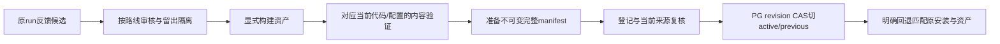

# 14｜固定评测、反馈审核、完整发布与回退

[上一章](13-observations.md) · [课程入口](README.md) · [源码导航](source-navigation.md)

## 业务问题与目标

改了Prompt后旧报告PASS还能发布吗？一次错误对话能否自动变训练答案？目标是把候选、gold、模型内容证据、版本门禁和active切换连起来。前置为检索签名、账本版本和证据边界。

## 先把数据角色说清楚

reference/train用于运行召回/训练；dev用于调参；冻结test用于未见内容验证；regression保留已知反例。source_group/variant_group控制原来源与改写族隔离，换订单号不算新独立样本。调试过的test不能继续宣称未见；同作者合成组不等于企业代表性。

反馈candidate是待核实对话，gold是每条路线显式审核、带来源/标签/独立性证据的答案。规则、Dense与FastText三路各自审核，批准不自动训练、发布或启用。原run、review revision、撤回和lease让处理可审计；不能把模型自己的答案直接当真值。

完整ReleaseManifest绑定模型/配置、Prompt工件、SOP snapshot、规则、语料/Embedding签名、FastText、精确runtime字节、验证报告及审核来源。运行核对的是当前字节和状态，文件hash相同只是必要条件；报告目标、版本与行为范围也必须适用。像Java可追溯制品与数据库CAS，但不是Git分支名一改就自动切换服务。

## 最小实验与预期

离线、模型0次；审计现有小冻结集并用合成报告结构演示原门禁，不运行完整质量评测、不发布：

```powershell
py -3.14 -m uv run --locked python -m deephelp_tools.learning.course evaluation
```

预期case_count=16、turns=20、synthetic_ratio=1；scenario_scale_complete/scale_500_complete均false。这是默认小冻结集，不把当前项目另有的548会话规模混进本次审计。synthetic_selected_gate.accepted=true只说明固定合成结构满足selected门禁；interrupted_gate/hard_failure_gate均false；empty_denominator.value=null。

按[evaluation_demo](../../modules/deephelp-tools/src/deephelp_tools/learning/course/evidence.py)看：audit读包内冻结原件核对来源/标签/分组；构造明确的合成selected报告；complete=False模拟中断，wrong_owner模拟安全失败；targeted_gate逐项拒绝。ratio空分母保留未知，不编100%通过。实验不生成可以注册发布的content报告。

## 原发布路径与源码



[quality.core.audit/score/targeted_gate/release_gate](../../modules/deephelp-tools/src/deephelp_tools/evaluation/quality/core.py)分开来源审计、逐条评分、定向范围和完整对照门禁。[flywheel.isolation/reviewed](../../modules/deephelp-tools/src/deephelp_tools/evaluation/feedback/flywheel.py)拒绝冻结留出回收、未经证据的gold；[feedback_store](../../modules/deephelp-app/src/deephelp_app/adapters/releases/feedback_store.py)持久审核修订与队列。

[release_assets.verify_release](../../modules/deephelp-app/src/deephelp_app/adapters/releases/release_assets.py)核对完整字节、Prompt最终请求、模型/SOP/资产/报告；[ReleaseStore.switch/_commit_switch](../../modules/deephelp-app/src/deephelp_app/adapters/releases/release_store.py)先验证，再在短PG事务锁channel，核对expected revision和READY/当前来源，保存active/previous与事件后commit。两个发布者不能各自以旧revision都成功。

从根可运行原离线反馈/发布反例；不执行云切换、模型API或修改正式active：

```powershell
py -3.14 -m uv run --locked pytest modules/deephelp-tools/tests/unit/feedback/test_m18_flywheel.py modules/deephelp-app/tests/unit/releases/test_m18_release.py -q
```

回退要恢复匹配原manifest的安装与配置；新注释也改变精确字节，不能手改旧manifest让它“适配”。待审批/UNKNOWN/历史run引用的原资产继续保留。源码Git回滚与业务active回退是两个操作。

## 常见误区与反例

- targeted PASS不等于全量/大规模PASS，报告必须写实际样本和能力范围。
- 重放/Mock/HTTP200不能替代改变模型内容后的真实验收。
- 旧PASS、任务SUCCEEDED或候选READY不自动授权发布，最终来源与完整门禁仍要满足。

## 练习与答案

只改代码注释是否改模型质量？是否影响runtime-v2绑定？一个候选从测试集复制并经人工点批准能训练吗？

答案：注释AST不变时无需live证明质量，精确源码字节仍变，旧安装/manifest仍属旧字节；未来正式发布另取匹配证据。来自留出组的候选即使点批准仍被isolation拒绝，人工操作不能消除污染。

完成课程后回到01章，用原请求解释每个等待者、判断者、事实源与收尾者；然后再按M35/M36明确授权进入页面学习路线。本M交付不启动下一模块。
